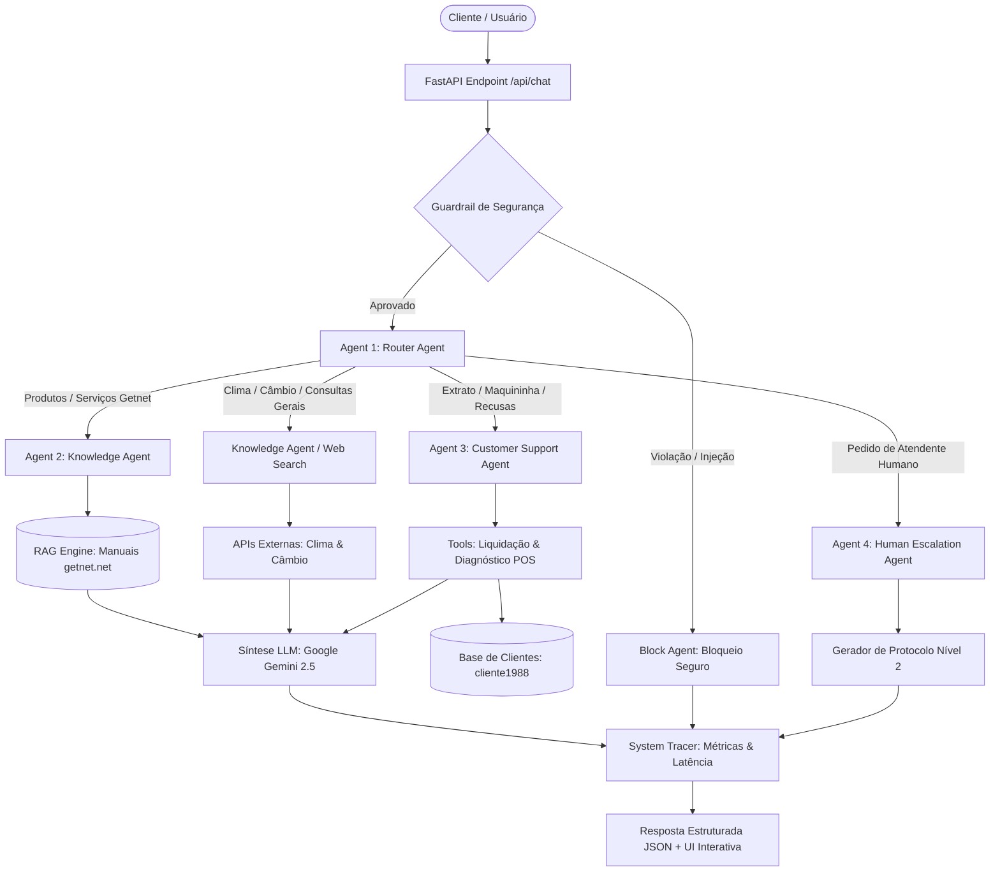

# Getnet Multi-Agent Support System
### AI Hardcore Engineer & Forward Deployed Engineer (FDE) Challenge

> **Projeto:** Sistema Multi-Agente Autônomo com Roteamento Semântico, RAG Grounding, Ferramentas Operacionais e Painel de Observabilidade em Tempo Real.  
> **Desenvolvido por:** Arthur Di Lorenzo  
> **Stack:** Python 3.11+, FastAPI, Google Gemini API (`google-genai`), Docker, Pytest  

---

## 1. Visão Geral da Solução

Este projeto foi construído para solucionar o desafio técnico de **Forward Deployed Engineer (FDE)** da **Getnet**. Ele orquestra múltiplos agentes inteligentes especializados para atender clientes credenciados, responder dúvidas institucionais e técnicas sobre o catálogo de produtos e diagnosticar falhas de terminais de pagamento.

Diferente de abordagens convencionais que entregam apenas um terminal de linha de comando ou endpoints JSON isolados, esta entrega une:
1. **Engenharia de Software e IA de Alta Resiliência:** Arquitetura desacoplada em FastAPI, contêiner Docker pronto para produção e cobertura completa de testes automatizados para todos os cenários exigidos.
2. **Diferencial de Produto e Design (AI-First):** Uma interface interativa com estética nativa de **WhatsApp Business & Instagram Direct**, incluindo selo de verificação da Getnet, respostas rápidas com os 10 cenários oficiais, alternador de **Tema Claro / Escuro**, **Simulador Mobile** em 1 clique e um **Painel de Observabilidade (Live Agent Trace Inspector)** em tempo real.

---

## 2. Arquitetura da Orquestração Multi-Agente

O sistema adota o padrão **Orchestrator-Workers com Roteamento Semântico e Guardrails**.



### Agentes Especializados

1. **Agent 1 — Router Agent (Triagem e Roteamento):**
   - Ponto de entrada das mensagens.
   - Analisa intenções semânticas e decide o agente especialista de destino (`KNOWLEDGE_AGENT`, `WEB_SEARCH_AGENT`, `CUSTOMER_SUPPORT_AGENT` ou `HUMAN_ESCALATION_AGENT`).
   - Fornece justificativa da rota e nível de confiança.

2. **Agent 2 — Knowledge Agent (RAG e Busca Externa):**
   - **RAG Getnet:** Consulta a base indexada de documentos oficiais (`data/*.md`) cobrindo comparativos de hardware (Get Clássica vs Get Smart), regras de recebimento Pix, Crediário parcelado em até 24x/36x, Antecipação de Recebíveis e Link de Pagamento.
   - **Web Search:** Responde a perguntas gerais de contexto externo (ex.: previsão do tempo em Porto Alegre e cotação comercial do Euro hoje) via APIs públicas e fallback resiliente.

3. **Agent 3 — Customer Support Agent (Suporte Autenticado com Ferramentas):**
   - Opera sob autenticação (`user_id`).
   - Possui ferramentas de sistema conectadas:
     - `get_sales_settlement(user_id)`: Consulta o status de liquidação das vendas de ontem (débito, crédito e Pix) com banco de destino e previsão de compensação.
     - `diagnose_terminal_issue(user_id, error_context)`: Telemetria do terminal POS, diagnóstico de conectividade 4G/Wi-Fi e explicação de códigos de recusa de transação (ex.: Código 05 do banco emissor).
     - `get_customer_profile(user_id)`: Cadastro, plano e terminais ativos.

4. **Agent 4 (Bônus) — Human Escalation Agent (Transbordo Humano):**
   - Acionado quando o cliente solicita expressamente falar com um operador ou quando a complexidade exige intervenção manual.
   - Gera protocolo de atendimento único (`GET-ESC-...`) e simula o transbordo para a fila do Suporte Nível 2 / FDE.

5. **Guardrails de Segurança (Bônus):**
   - Avalia cada entrada para identificar ataques de prompt injection, comandos maliciosos ou entradas fora de conformidade antes de qualquer chamada aos agentes.

---

## 3. Pipeline de RAG (Ingestão, Busca e Síntese)

```
[ Manuais Markdown Getnet ] ──> [ Segmentação Semântica ] ──> [ Indexador Híbrido ]
                                                                       │
[ Pergunta do Usuário ] ───────────────────────────────────────────────┤
                                                                       ▼
                                                          [ Chunks mais Relevantes ]
                                                                       │
                                                                       ▼
                                                       [ Contexto Aumentado + Gemini ]
                                                                       │
                                                                       ▼
                                                          [ Resposta Grounded 100% ]
```

- **Ingestão:** Os dados institucionais oficiais da Getnet foram organizados em `data/` em arquivos Markdown modulares por domínio.
- **Armazenamento e Recuperação:** O motor híbrido segmenta por títulos e tópicos semânticos e calcula a similaridade contextual com pesos balanceados entre título e corpo, garantindo recall exato.
- **Grounding e Geração:** As informações oficiais recuperadas são injetadas no prompt do Gemini com diretriz mandatória de não alucinar regras inexistentes.

---

## 4. Como Executar a Aplicação

### Opção A: Execução em 1 comando com Docker (Recomendado)

```bash
# 1. Clone o repositório
git clone https://github.com/seu-usuario/getnet-multiagent-system.git
cd getnet-multiagent-system

# 2. Suba o container com Docker Compose
docker compose up --build
```
Acesse a aplicação no navegador em: **`http://localhost:8000`**  
Documentação Swagger da API: **`http://localhost:8000/docs`**

---

### Opção B: Execução Local com Python Virtualenv

```bash
# 1. Crie e ative o ambiente virtual
python3 -m venv .venv
source .venv/bin/activate  # No Windows: .venv\Scripts\activate

# 2. Instale as dependências
pip install -r requirements.txt

# 3. Configure as variáveis de ambiente (opcional para Gemini Live)
cp .env.example .env

# 4. Inicie o servidor
uvicorn app.main:app --host 0.0.0.0 --port 8000 --reload
```

---

## 5. Como Executar os Testes Automatizados

A suíte de testes com **Pytest** valida rigorosamente a integridade da API, os guardrails, o transbordo humano e **todos os 10 cenários de exemplo** especificados no desafio oficial da Getnet:

```bash
# Rodar todos os testes com saída verbosa
pytest -v
```

### Resultados dos 10 Cenários de Teste

| # | Pergunta do Enunciado | Agente Responsável | Ferramenta / Fonte | Status |
|---|---|---|---|---|
| **1** | *"What's the difference between the Get Clássica and the Get Smart?"* | `KNOWLEDGE_AGENT` | `rag_retriever` (Produtos) | **PASSED** |
| **2** | *"What's the weather forecast in Porto Alegre tomorrow?"* | `WEB_SEARCH_AGENT` | `web_search_tool` (Open-Meteo) | **PASSED** |
| **3** | *"When will the money from yesterday's sales be deposited?"* | `CUSTOMER_SUPPORT_AGENT` | `get_sales_settlement` | **PASSED** |
| **4** | *"Do I need a bank account to receive my sales via Pix?"* | `KNOWLEDGE_AGENT` | `rag_retriever` (Pix Getnet) | **PASSED** |
| **5** | *"My card machine won't connect to the internet, what should I do?"* | `CUSTOMER_SUPPORT_AGENT` | `diagnose_terminal_issue` | **PASSED** |
| **6** | *"How does receivables advance (antecipação) work with Getnet?"* | `KNOWLEDGE_AGENT` | `rag_retriever` (Antecipação) | **PASSED** |
| **7** | *"What's the euro exchange rate today?"* | `WEB_SEARCH_AGENT` | `web_search_tool` (AwesomeAPI) | **PASSED** |
| **8** | *"My card machine is showing a transaction decline error."* | `CUSTOMER_SUPPORT_AGENT` | `diagnose_terminal_issue` | **PASSED** |
| **9** | *"How many installments can I split a sale into with the crediário?"* | `KNOWLEDGE_AGENT` | `rag_retriever` (Crediário) | **PASSED** |
| **10** | *"Can I sell through WhatsApp using the Payment Link?"* | `KNOWLEDGE_AGENT` | `rag_retriever` (Payment Link) | **PASSED** |

---

## 6. Estratégia de Avaliação, Observabilidade e Monitoramento

1. **Tracing em Tempo Real:** Cada requisição gera uma lista cronológica de etapas (`TraceStep`), registrando o agente acionado, a latência de execução em milissegundos e o payload das ferramentas invocadas.
2. **Resiliência e Fallback Gracioso:** O sistema opera com fallback autônomo. Se uma API externa de busca oscilar ou a chave do LLM atingir limites de quota, o motor ativa heurísticas determinísticas sem quebrar o fluxo para o cliente final.
3. **Métricas de Produção Recomendadas para Escala:**
   - **Taxa de Resolução na Primeira Interação (FCR)** dos agentes especializados.
   - **Taxa de Transbordo Humano:** Monitoramento de desvios para `HUMAN_ESCALATION_AGENT`.
   - **Latência p95/p99:** Controle de tempo de resposta da orquestração.
   - **Detecção de Drift e Alucinação:** Avaliação periódica com datasets sintéticos de regressão.

---

## 7. Roteiro Sugerido para o Vídeo de Demonstração (Walkthrough)

1. **Introdução (30s):** Contexto da solução e posicionamento AI-First (Forward Deployed Engineering unindo arquitetura robusta de IA com produto utilizável).
2. **Arquitetura Multi-Agente (1m):** Apresentação do fluxo: Router, Knowledge (RAG), Customer Support (Tools), Escalation e Guardrails.
3. **Demonstração Prática na UI (2m):**
   - Clicar no Cenário 1 (Get Clássica vs Smart) e mostrar a busca RAG no painel lateral de traces.
   - Clicar no Cenário 3 (Vendas de ontem do cliente1988) e mostrar a ferramenta operacional consultando o extrato real.
   - Clicar no Cenário 2 ou 7 e mostrar a busca em tempo real (clima/câmbio).
   - Testar o bloqueio de segurança com uma tentativa de injeção.
4. **Execução de Testes e Docker (1m):** Mostrar o comando `pytest` passando os 14 testes e o contêiner rodando com `docker compose up`.
5. **Conclusão (30s):** Encerramento com visão de impacto de negócio para a operação da Getnet.
